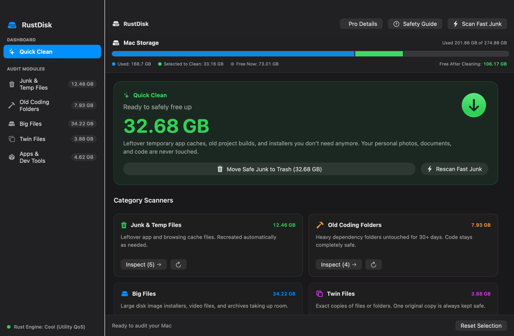
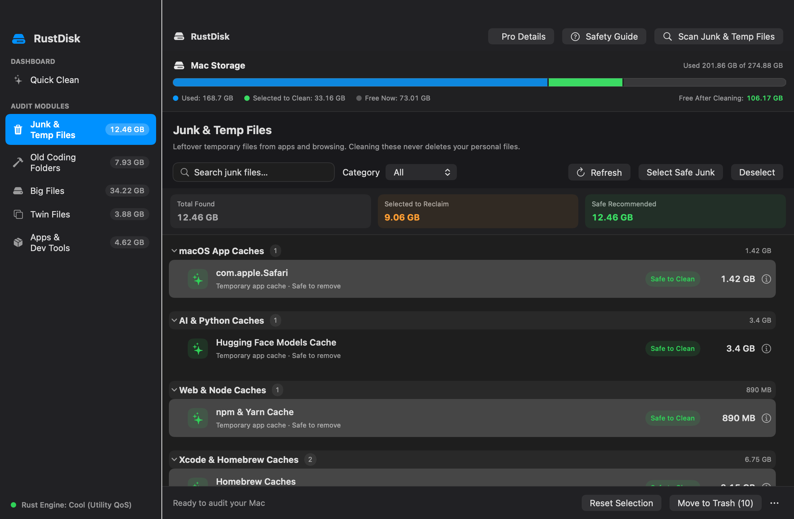
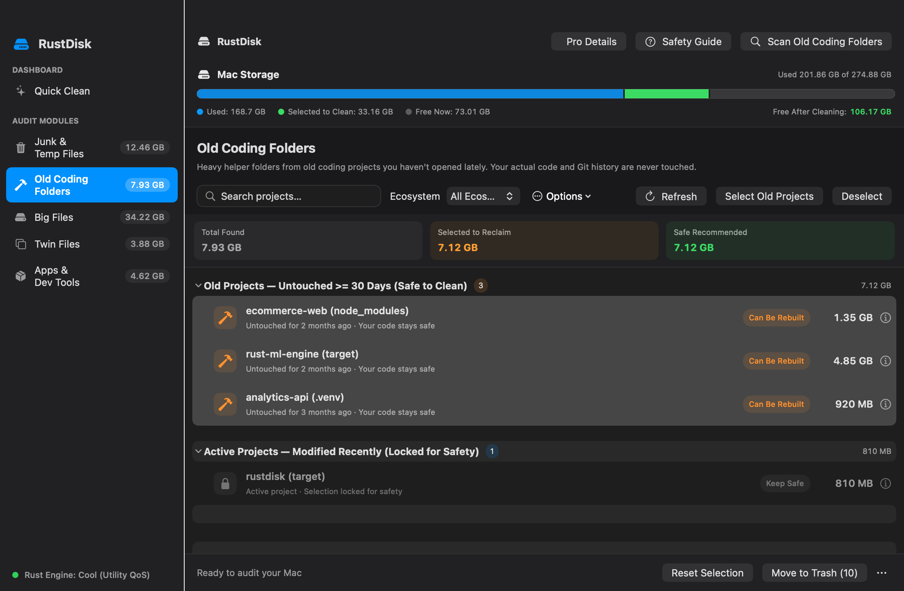
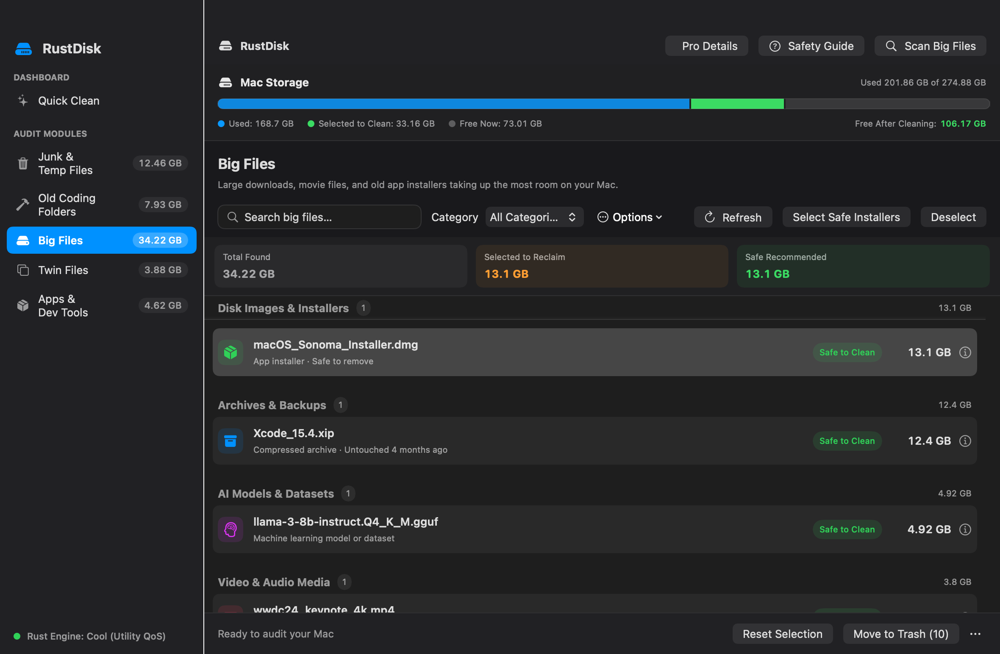
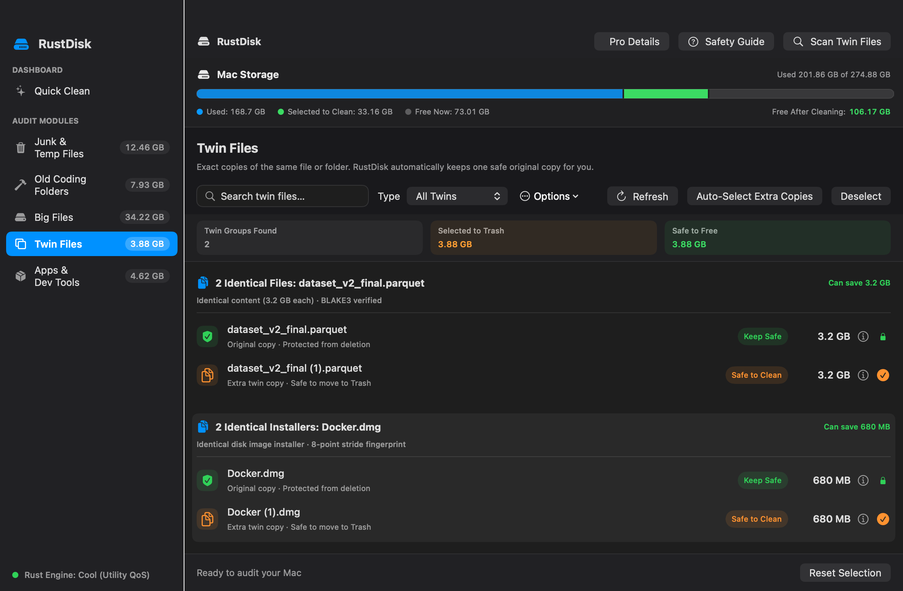

# 🦀 RustDisk

**A high-performance macOS disk cleaner built with Rust and SwiftUI.**

[](https://github.com/rifatahsanpul0k/rustDisk/actions/workflows/ci.yml)
[](https://www.apple.com/macos/)
[](https://www.apple.com/mac/)
[](LICENSE)



---

## Why This Exists

Every MacBook ships with 256 GB or 512 GB of storage. Between Xcode's ever-expanding `DerivedData`, nested `node_modules` trees across dozens of forgotten projects, Homebrew caches, Python virtual environments, and Docker's sparse virtual disks, real reclaimable space is invisible inside macOS's native Storage UI.

RustDisk is a **systems-level answer to a systems-level problem.** It is written at the language layer where APFS block allocation is native — not wrapped in Electron, not throttled by a webview, not guessing from file metadata alone. The scanner queries Unix allocated blocks (`st_blocks × 512`) to surface *physical* disk pressure rather than misleading logical file sizes.

---

## 📸 Screenshots & Visual Tour

RustDisk is designed around **Jakob Nielsen's 10 Usability Heuristics** — spacious, calm, and friendly for everyday users (aged 13+) while retaining deep technical rigor for power users.

### 1. 🚀 Quick Clean (Home Dashboard)
*One-click safe cleanup with an instant visual breakdown of your Mac's internal storage.*


- **Storage Meter:** Real-time APFS allocation bar showing currently used, selected to clean, free now, and projected free space after cleanup.
- **Hero Clean Action:** Safely reclaims temporary caches and stale build outputs without touching personal documents, pictures, or code.
- **Interactive Category Cards:** Scan only the categories you want, when you want.

---

### 2. 🧹 Junk & Temp Files
*Leftover application and browsing caches. Cleaning these never affects your personal files.*



- **3-Element Row Rule:** Every item displays an icon + bold friendly title with a plain-English explanation, a single safety badge, and its physical disk footprint.
- **Progressive Disclosure:** Deep Unix paths, physical vs. logical byte deltas, and block metrics remain cleanly tucked away behind the toolbar **"Pro Details"** toggle or row `ⓘ` popover.
- **Zero Risk:** Recreated automatically by macOS or apps as needed.

---

### 3. 🛠️ Old Coding Folders
*Heavy dependency folders from old software projects you haven't opened lately. Your source code and Git history are never touched.*



- **Activity-Aware Safety:** Automatically identifies `node_modules`, Rust `target/`, Python `.venv`, Swift `.build/`, and Gradle trees untouched for 30+ days.
- **Active Project Lock:** Projects modified recently are highlighted with a lock icon and protected from accidental deletion.
- **Restore Hints:** Built-in re-installation commands (`npm install`, `cargo build`, `pip install`) displayed on demand.

---

### 4. 📦 Big Files Finder
*Large downloads, movie files, VM images, and old installers taking up the most room on your Mac.*



- **Categorized Inspection:** Disk images & installers (`.dmg`, `.pkg`, `.iso`), compressed archives (`.zip`, `.tar`, `.xip`), AI weights (`.gguf`, `.bin`), and 4K video media.
- **Filter & Search:** Real-time search by filename or file type.

---

### 5. 🔍 Twin Files (Duplicates)
*Exact copies of identical files or folders. RustDisk automatically keeps one safe original copy for you.*



- **Guaranteed Safe Originals:** RustDisk automatically marks the oldest or primary file as **"Keep Safe"** and pre-selects only redundant extra copies.
- **Multi-Point Sparse Fingerprinting:** Files $\ge$ 1 GiB use deterministic 8-window stride sampling with `F_NOCACHE`, matching multi-gigabyte files in milliseconds without polluting Apple Silicon Unified Memory.
- **BLAKE3 Cryptographic Verification:** Eliminates false positives with cryptographic integrity.

---

## Architecture & Performance

```
┌────────────────────────────────────────────────────────────────────────┐
│  SwiftUI Native Front-end  (macos-app/)                                │
│  ┌──────────────────────────────────────────────────────────────────┐  │
│  │  DiskAuditViewModel (On-Demand Category Scanning + Thermal QoS)  │  │
│  │  NavigationTab  →  Audit Views (Enforcing 3-Element Row Rule)    │  │
│  └───────────────────────────────┬──────────────────────────────────┘  │
│                   UniFFI FFI Bridge (Generated Swift + C header)       │
│                   ↕ librustdisk_core.a (Zero-dylib Static Archive)     │
│  ┌──────────────────────────────────────────────────────────────────┐  │
│  │  Rust Engine  (rust-core/)                                       │  │
│  │  jwalk + rayon → Multi-threaded APFS directory traversal         │  │
│  │  libc::pthread_set_qos_class_self_np → Utility / Background QoS  │  │
│  │  libc::setiopolicy_np → IOPOL_UTILITY / IOPOL_THROTTLE disk I/O  │  │
│  │  libc::fcntl(F_NOCACHE) → Zero Unified Memory cache pollution    │  │
│  │  BLAKE3 content hashing · 8-point stride sparse fingerprinting   │  │
│  │  System Armor blocklist · Trash / permanent delete modes         │  │
│  └──────────────────────────────────────────────────────────────────┘  │
└────────────────────────────────────────────────────────────────────────┘
```

### Key Engineering Decisions

| Feature | Implementation | Benefit |
|---|---|---|
| **Adaptive Thermal Pacing** | `pthread_set_qos_class_self_np` + `setiopolicy_np` | Dispatches heavy scan threads to Apple Silicon Efficiency Cores (`E-cores`), keeping your Mac cool and silent. |
| **On-Demand Scans** | Category-isolated scanning routines | Scan individual categories in seconds without locking or scanning the entire filesystem. |
| **Unified Memory Armor** | `libc::fcntl(fd, F_NOCACHE, 1)` | Direct-to-buffer disk reads bypass macOS Unified Memory cache, preventing running apps from being evicted. |
| **Sparse Stride Hashing** | 8-point 64 KiB window sampling for files $\ge$ 1 GiB | Fingerprints multi-gigabyte VM disks, AI models, and installers reading only 512 KiB per file. |
| **APFS Physical Accuracy** | `st_blocks × 512` Unix block evaluation | Correctly handles APFS sparse files, clones, and compression without reporting phantom bytes. |
| **Zero Runtime Dependencies** | Mozilla UniFFI + Rust `staticlib` | Self-contained single-binary native macOS app with zero webviews, Node runtimes, or external frameworks. |

---

## 🛡️ Safety First: System Armor

Every path — both as entered and after `canonicalize` resolves symlinks — is verified against a **case-insensitive** safety blocklist before any deletion or move-to-trash operation is permitted:

| Protected Scope | Rule |
|---|---|
| OS & system binaries | `/System`, `/bin`, `/sbin`, `/usr`, `/Applications`, all of `/Library` |
| Third-party installs | `/opt` **except** strict children of `/opt/homebrew` |
| User accounts | `/Users` and every user home directory root |
| Sensitive credentials | Any path component named `.git`, `.ssh`, `.gnupg`, `.aws` |
| Container VMs | `Docker.raw` in any casing |
| Relative traversal | Paths containing `..` are rejected outright |

**Safe Batch Cleanup:**
- **macOS Trash by Default:** Selected items are moved safely to macOS Trash (`~/.Trash`), allowing instant single-click restoration via Finder ("Put Back").
- **Permanent Deletion Guard:** Optional permanent deletion requires explicit secondary confirmation with an itemized breakdown.
- **Cooperative Cancellation:** `cancel_active_scan()` halts all background worker threads and I/O loops instantaneously.

---

## Installation

1. Go to [**Releases**](https://github.com/rifatahsanpul0k/rustDisk/releases) and download the latest `RustDisk-macos-arm64.dmg`.
2. Open the `.dmg` and drag **RustDisk.app** into your **Applications** folder.
3. Launch RustDisk, then grant **Full Disk Access**:
   > **System Settings → Privacy & Security → Full Disk Access → Enable RustDisk**

> **System Requirements:** macOS 13 Ventura or later · Apple Silicon Mac (M1, M2, M3, M4).

---

## Build from Source

### Prerequisites

- Rust (stable toolchain) with `aarch64-apple-darwin` target:
  ```bash
  rustup target add aarch64-apple-darwin
  ```
- Xcode 15+ with Swift 5.9+

### Build Steps

```bash
# 1. Clone the repository
git clone https://github.com/rifatahsanpul0k/rustDisk.git
cd rustDisk

# 2. Compile the Rust core and generate UniFFI Swift bindings
./scripts/build_rust_bridge.sh

# 3. Build the macOS application
swift build --package-path macos-app --configuration release --arch arm64

# 4. Package a distributable DMG
./scripts/package_dmg.sh
# → dist/RustDisk-macos-arm64.dmg
# → dist/RustDisk-macos-arm64.dmg.sha256
```

### Run Checks Locally

```bash
# Run Rust tests and format check
cargo fmt  --manifest-path rust-core/Cargo.toml -- --check
cargo test --manifest-path rust-core/Cargo.toml

# Compile Swift app in debug mode
swift build --package-path macos-app --configuration debug --arch arm64
```

---

## Repository Layout

```
rust-core/                       Rust scanner, thermal throttling & cleaner engine
  src/lib.rs                     UniFFI interface surface (exported types & functions)
  src/scanner.rs                 jwalk + rayon APFS crawler
  src/thermal.rs                 QoS thread scheduling, IOPOL_THROTTLE & adaptive sleep
  src/duplicates.rs              3-tier duplicate detection & 8-point stride sampling
  src/cleaner.rs                 CleanupReport, System Armor & trash/permanent deletion
  src/packages.rs                Terminal package manager detection & measurement
  uniffi-bindgen.rs              CLI binary driving UniFFI code generation

macos-app/                       SwiftUI native front-end
  Package.swift                  SwiftPM manifest linking librustdisk_core.a
  RustDisk/Generated/            Generated UniFFI Swift file + C header
  RustDiskCoreFFI/               SwiftPM system-library target for the generated C header
  RustDisk/ViewModels/           DiskAuditViewModel — single source of truth for UI state
  RustDisk/Views/                SwiftUI views (one file per navigation tab)
  RustDisk/ScreenshotCapture.swift Automated headless Retina screenshot generator

docs/images/                     High-resolution dark mode screenshots for documentation
scripts/
  build_rust_bridge.sh           Compile aarch64 release → generate Swift bindings → stage .a
  package_release_app.sh         Build and sign dist/RustDisk.app
  package_dmg.sh                 Wrap app into a compressed, release-ready DMG
```

---

## License

This project is licensed under the [MIT License](LICENSE).
